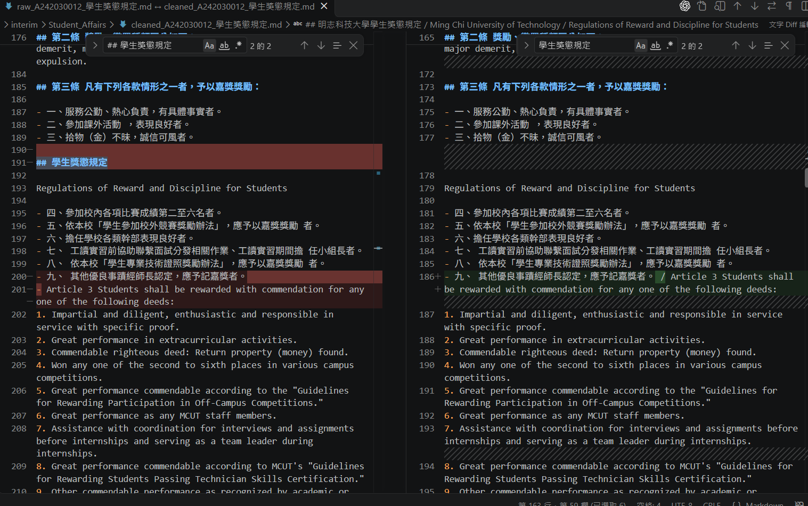
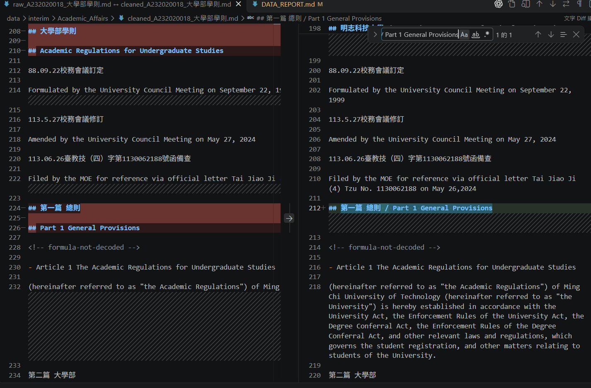
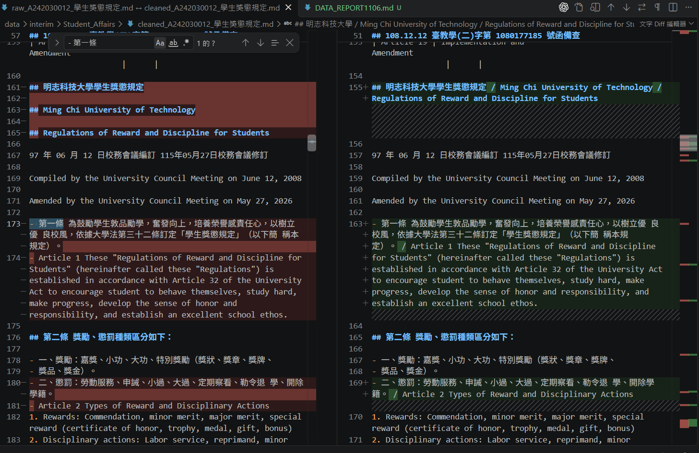
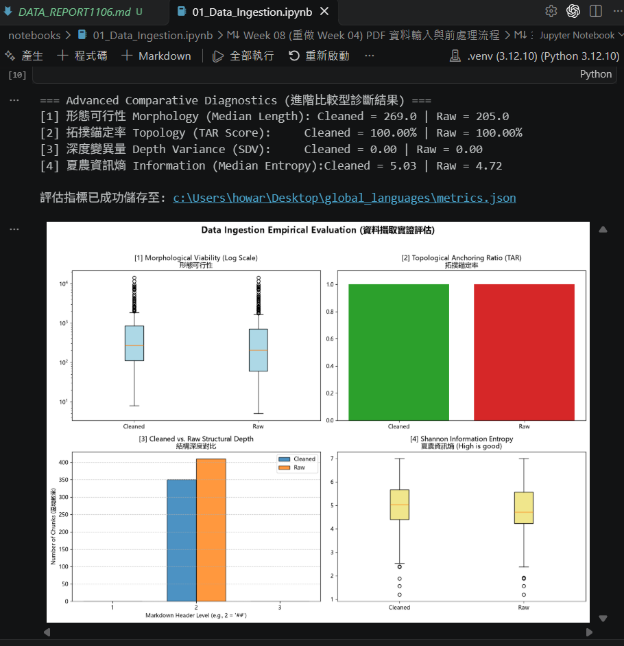

# 資料前處理報告 (Data Preparation Report)

- **學號 / 姓名**：U12627013 / 林正皓
- **專案名稱**：明志科技大學規章文件資料前處理
- **完成的任務**：- [x] 1-A 頁首頁尾清除　- [x] 1-B 雙語標題合併　- [x] 1-C 雙語條文合併

---

## 1. 資料集概覽 (Dataset Overview)

| 類別 (Cluster) | PDF 數量 | 清洗前 chunk 數 | 清洗後 chunk 數 |
|---|---|---|---|
| Academic_Affairs | 3 | 96 | 67 |
| Library_Information | 3 | 248 | 228 |
| Student_Affairs | 3 | 66 | 55 |
| **合計** | **9** | **410** | **350** |

**問題 (2–3 句)：** 清洗後 chunk 數量變少了多少？是哪個任務造成的？有沒有哪個任務**不影響** chunk 數量？為什麼？

清洗後共少了 60 個 chunk。依 Notebook 的執行順序拆開計算，1-A 移除重複文件名稱頁首後少 14 個，1-B 合併雙語標題後再少 46 個；1-C 合併條文不影響數量，因為切塊只在 `## ` 標題處分開，而 1-C 改的是一般條文文字。

## 2. 清洗步驟 (Cleaning Steps)

### 2.1 任務 1-A：頁首頁尾溢出清除

- 檔名：`data/interim/Student_Affairs/raw_A242030012_學生獎懲規定.md`　搜尋的文字：`## 學生獎懲規定`（第 191 行）
- 比較圖 (存為 `reports/figures/1a_compare.png`)：
- 改變了什麼：清洗前在條文內容中出現的獨立文件名稱頁首「## 學生獎懲規定」被移除；相鄰條文與英文內容保留。
- 這對之後的問答檢索有什麼幫助：減少重複頁首造成的雜訊，避免搜尋結果被文件名稱而非條文內容主導。
- 這個任務有沒有**改錯**的地方 (把不該改的也改了)？若有，寫出檔名與搜尋的文字；若沒有，寫「沒有發現」：在這處實際比對中沒有發現誤刪；相鄰條文與英文內容仍在。

### 2.2 任務 1-B：雙語標題合併

- 檔名：`data/interim/Academic_Affairs/raw_A232020018_大學部學則.md` ↔ `data/interim/Academic_Affairs/cleaned_A232020018_大學部學則.md`　搜尋的文字：`Part 1 General Provisions`（raw 第 226 行；cleaned 第 212 行）
- 比較圖 (存為 `reports/figures/1b_compare.png`)：
- 改變了什麼：清洗前的 `## 第一篇 總則` 和 `## Part 1 General Provisions` 是兩個分開的標題；清洗後合併為 `## 第一篇 總則 / Part 1 General Provisions`。
- 這對之後的問答檢索有什麼幫助：中英文標題放在同一個標題中，使用中文或英文搜尋時，都較容易找到同一篇章。
- 這個任務有沒有**改錯**的地方 (把不該改的也改了)？若有，寫出檔名與搜尋的文字；若沒有，寫「沒有發現」：這處沒有發現誤合併，中英文標題都指向同一篇章。
### 2.3 任務 1-C：雙語條文合併

- 檔名：`data/interim/Student_Affairs/raw_A242030012_學生獎懲規定.md`　搜尋的文字：`- 第一條`（第 173 行）
- 比較圖 (存為 `reports/figures/1c_compare.png`)：
- 改變了什麼：中文第一條與英文 Article 1 原本分列兩行，清洗後接在同一條目，並以斜線分隔。
- 這對之後的問答檢索有什麼幫助：中文與英文的對應內容共同出現在同一區塊，使用其中一種語言查詢時也能取得另一語言的條文文字。
- 這個任務有沒有**改錯**的地方 (把不該改的也改了)？若有，寫出檔名與搜尋的文字；若沒有，寫「沒有發現」：在這條實際比對中沒有發現誤合併；中文第一條與英文 Article 1 對應同一條文。

## 3. 評估指標與 AI 解讀查證 (Metrics & Verifying the AI's Interpretation)

### 3.1 指標數據表

| 指標 | Raw | Cleaned (你的) | Cleaned (參考值) |
|---|---|---|---|
| [1] 中位數長度 Median Length | 205.0 | 269.0 | 270.5 |
| [2] 拓撲錨定率 TAR | 1.0 | 1.0 | 1.0 |
| [3] 深度變異量 SDV (選填) | 0.0 | 0.0 | 0.0 |
| [4] 中位數資訊熵 Entropy (選填) | 4.719958679606001 | 5.033184175406309 | 5.0623172389748445 |



你的 Cleaned 結果與參考值一致嗎？若一致，寫「一致」；若不一致，找出原因。（1 句）

與參考值略有差異：TAR、SDV 相同，我的 Cleaned 長度中位數低約 0.55%、資訊熵低約 0.58%；參考圖中的 Raw 熵也比本地高約 0.0030，表示差異在清洗前已出現，而本地九份 cleaned Markdown 都能由目前 Notebook 規則重現，且 `requirements.txt` 沒有鎖定 Docling 版本，因此較可能是參考與本地的原始 Markdown／PDF 轉換或指標版本略有不同，並非 SEED 造成；這些長度與字元熵差距本身不足以判斷哪個結果更好。

### 3.2 AI 的解讀

- 使用的 AI 工具：OpenAI Codex

```text
從本地儀表板看，Cleaned 的長度中位數由 205 增至 269，資訊熵由 4.72 增至 5.03；TAR 前後都是 100%，SDV 都是 0。這表示本地 chunk 稍長、字元分布稍多樣，但這些指標不能直接代表檢索效果。與老師提供的參考值相比，本地 Cleaned 的中位數低 1.5、資訊熵低約 0.0291；而 Raw 熵值也低約 0.0030，表示至少 Raw 基準已有些差異。本地九份清洗檔可由目前 Notebook 規則重現，`requirements.txt` 也沒有鎖定 Docling 版本，因此資料轉換或計算版本不同是可能原因，但現有資料還不能確認是哪一項。
```

### 3.3 你的查證 (至少兩點)

**查證 1**
- AI 的說法：本地 Cleaned 長度中位數和資訊熵略低於參考值。
- 我查了什麼：專案根目錄的 `metrics.json` 與老師提供的參考值截圖。
- 結論：正確。本地是 269.0 和 5.033184，參考值是 270.5 和 5.062317，分別相差 1.5 和約 0.0291。

**查證 2**
- AI 的說法：Raw 熵值也有差異，所以不能只用本地的 1-A、1-B、1-C 解釋 Cleaned 數值差距。
- 我查了什麼：`metrics.json` 的 Raw 熵值、參考截圖中的 Raw 熵值，以及依 Notebook 規則重現的九份清洗 Markdown；也查看 `requirements.txt` 是否鎖定 Docling 版本。
- 結論：部分正確。Raw 熵本地為 4.719959、參考值為 4.722967，確定清洗前就有差異；本地清洗檔與 Notebook 規則相符，且 Docling 版本未鎖定，但僅憑這些資料仍無法確認參考差異具體來自哪份原始資料或計算版本。

### 3.4 實際證據：你被指定的 chunk

- **SEED**：1106

**(a) 很長的 chunk**
- 資料檔 (JSON)：`data/processed/Student_Affairs/cleaned_A242030012_學生獎懲規定_processed.json`　位置：第 1 個 (從 0 開始)　長度：4828 字元　驗證碼：`cb54ac07`
- 閱讀用檔案 (`.md`)：`data/interim/Student_Affairs/cleaned_A242030012_學生獎懲規定.md`　從第 51 行開始
- 前 3 行內容：
  ```text
  ## 108.12.12 臺教學(二)字第 1080177185 號函備查

  Approved for recordation by Letter Tai-Jao-Xue-(II) No. 1080177185 dated 2019.12.12
  ```
- 這個 chunk 包含多次修訂與函文備查紀錄、中英文版本、著作權資訊，以及「目錄 Table of Contents」條目。它會這麼長，是因為切塊以 `## ` 標題作為邊界，這些內容之間沒有新的 `## ` 標題，因此被收在同一個 chunk。
- 這麼長的 chunk 會同時包含多種資訊；檢索特定修訂日期或條文時，相關內容可能被大量目錄與沿革文字稀釋，也可能超出模型一次處理內容的理想長度，降低回答聚焦度。

**(b) 資訊熵很低的 chunk**
- 資料檔 (JSON)：`data/processed/Library_Information/cleaned_A271010023_圖書館管理作業規範_processed.json`　位置：第 169 個 (從 0 開始)　資訊熵：2.40　驗證碼：`211d17ef`
- 閱讀用檔案 (`.md`)：`data/interim/Library_Information/cleaned_A271010023_圖書館管理作業規範.md`　從第 1875 行開始
- 內容：
  ```text
  ## 明志科技大學圖書館 退休教職員及校友借書申請單

  | 讀             | 填表日期             | 西元 年   | 月 日                             | 姓名                              |
  |----------------|----------------------|-----------|-----------------------------------|-----------------------------------|
  | 者 資          | 身分證字號/ 護照號碼 |           |                                   | 聯絡 電話                         |
  |                | E-mail               | 料        | 料                                | 料                                |
  | 讀 者 在 校 身 | □校友                | 學號      |                                   |                                   |
  |                | □校友                | 學制      | ○四技 ○研究所 ○二技 ○專科 ○其他： | ○四技 ○研究所 ○二技 ○專科 ○其他： |
  |                | □校友                | 畢業系所  |                                   |                                   |
  | 分             | □退休教職員          | 服務單位  |                                   |                                   |

  | 圖書館收件   | 西元   | 年   | 月 日   | 收件經辦            |
  |--------------|--------|------|---------|---------------------|
  | 有效期間     | 西元   |      | 年 月   | 日 至 西元 年 月 日 |
  ```
- 熵值低是因為這是制式申請表：欄位名稱、空白儲格、重複的表格結構很多，字元種類與分布較集中。若問題是退休教職員或校友借書申請所需欄位，這個 chunk 仍有用；若問題詢問圖書館規範條文或借閱規則，表單內容幫助有限，且表格轉換後部分欄位可能錯位。

## 4. 一個尚未解決的問題 (One Remaining Problem)

- **檔名** (`cleaned_*.md`)：`data/interim/Academic_Affairs/cleaned_A231060004_學生申請期中停修課程實施要點.md`　**從第 73 行開始**　**標題**：`## 表單號碼：A031060104`
- **我是怎麼找到的**：從第 3.4 節指定的兩個 chunk 以外，檢查 `cleaned_*.md` 的標題分界；看到文件結尾的表單號碼標題後，再對照同名 Raw 檔確認它原本就以 `## ` 開頭。
- **問題 chunk (貼上部分內容)**：

```text
## 表單號碼：A031060104
```

- **問題是什麼**：這個 chunk 只有表單號碼標題，沒有其他文字或表單內容。
- **可能的原因**：同名 Raw 檔中也已有 `## 表單號碼：A031060104`，因此問題較可能出在 PDF 轉 Markdown 時把表單號碼辨識成標題；後續切塊規則 `\n(?=##\s)` 再依這個標題切出獨立 chunk。不是清洗規則新增了這個標題。
- **具體的修正方法**：把 `## 表單號碼：A031060104` 當作一般文字或文件 metadata，不讓它成為新的 chunk 標題；例如在切塊前將 `## 表單號碼：...` 的 `## ` 移除，讓表單號碼留在前一段表單內容中。
- **對問答檢索的影響**：只搜尋表單號碼時可能只會取回這個沒有說明的 chunk，無法得知它對應哪份表單或如何使用。

## 5. AI 協作 (AI Collaboration)

- 本次作業的 AI 協作紀錄請見 [`AI_USAGE.md`](AI_USAGE.md) 的「Week 04 / 08」與「Week 09」段落。
- 這次使用 AI 最大的收穫或教訓是：提示詞除了要說清楚哪些內容要合併，也要寫出哪些情況不能合併；用相鄰中文標題和條文做反例後，我比較能確認規則不會只因為文字靠在一起就把它們接起來。這次對照參考值時也發現，數字略有差異不代表誰一定比較好，還要先確認原始資料和轉換版本是否一致，再回到實際 chunk 檢查。
